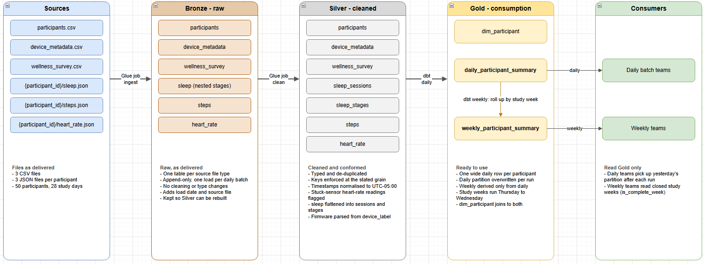
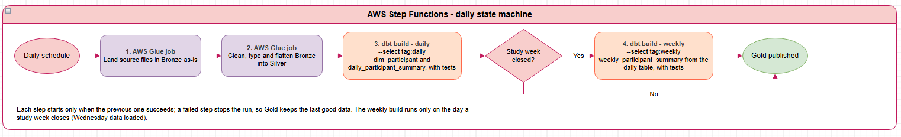

# PMData Wearable Data Model

Design proposal for turning the PMData synthetic wearable dataset into tables
that teams can consume daily and weekly. The dataset covers 50 participants over
28 days (2026-01-08 → 2026-02-04): Fitbit steps, heart rate and sleep, plus a
daily wellness survey.

This repository holds the design only — the data model, the architecture
diagrams and their documentation. No pipeline code is implemented yet.

## Architecture

The data moves through a medallion architecture: sources are landed as-is in
Bronze, cleaned in Silver and aggregated in Gold, which is the only layer
consumers read.

A daily AWS Step Functions state machine runs the load. AWS Glue jobs build
Bronze and Silver; dbt builds the Gold models, with the weekly build running
only when a study week closes.

## Gold tables

| Table | Grain | For |
|---|---|---|
| `dim_participant` | participant | Participant and device attributes |
| `daily_participant_summary` | participant-day | Teams that ingest daily |
| `weekly_participant_summary` | participant-study week | Teams that need weekly data |

The weekly table is derived only from the daily table. Study weeks run Thursday
to Wednesday, giving four complete weeks.

## Repository layout

| Path | Contents |
|---|---|
| [data_dictionary.md](data_dictionary.md) | Field definitions for the source files |
| [docs/data_model.md](docs/data_model.md) | Layers, consumption tables, metric definitions and open items |
| [docs/modeling/main_model.dbml](docs/modeling/main_model.dbml) | Full table model in DBML |
| [docs/diagrams/medallion_architecture.drawio](docs/diagrams/medallion_architecture.drawio) | Editable source of the two diagrams above |
| [docs/img/](docs/img) | Exported diagram images |
| `data/` | Dataset files; not tracked in git |

## Viewing the diagrams

- **DBML**: open `main_model.dbml` with a DBML viewer extension in VS Code, or
  paste it into [dbdiagram.io](https://dbdiagram.io).
- **draw.io**: open the `.drawio` file in [diagrams.net](https://app.diagrams.net)
  or with the Draw.io Integration extension in VS Code.
